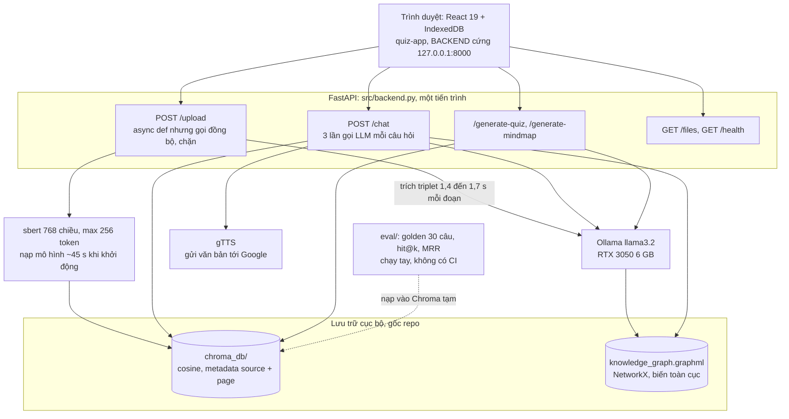
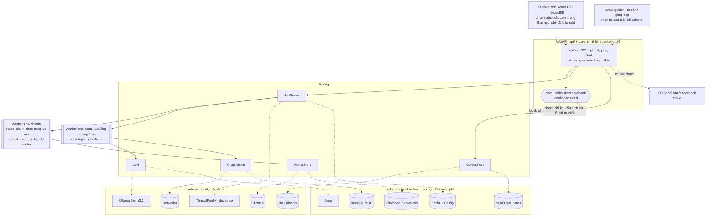
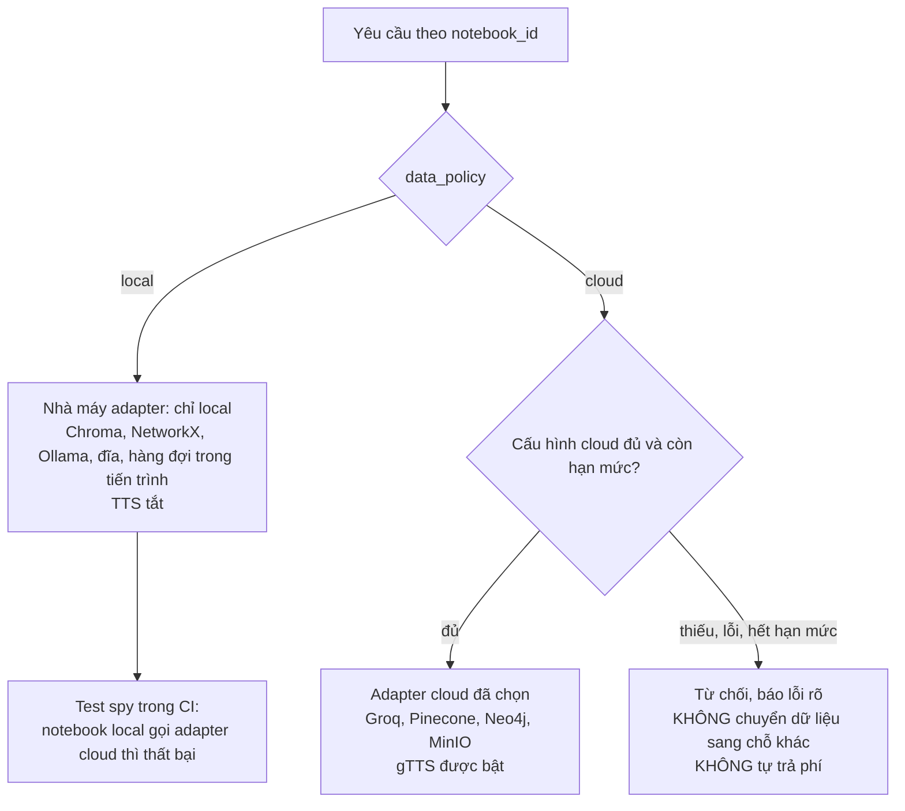
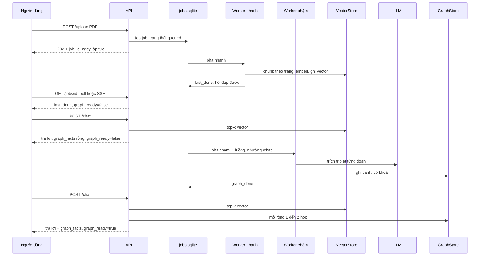
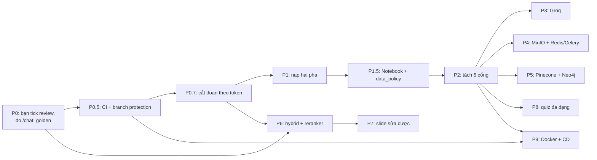

# My-NotebookLM — Toàn cảnh nâng cấp (bản nháp để chủ dự án quyết định)

> Trạng thái: đã ghi vào repo 2026-10-27 theo lệnh của chủ dự án (chưa commit). Mọi số liệu có nguồn hoặc ghi "chưa kiểm chứng". Ngày soạn: 2026-10-27.
> Cách dùng: đọc mục 1 → 3 để nắm tình hình, xem sơ đồ ở mục 2, 4, 5, 6, rồi trả lời các quyết định ở mục 10. Sửa trực tiếp file này; Leader sẽ cập nhật PLAN.md theo bản bạn chốt.

## 1. Hành trình từ sơ đồ AWS đến hiện tại
| Mốc | Điều đã xảy ra | Kết quả kiểm chứng được |
|---|---|---|
| Ban đầu | Bạn đưa sơ đồ AWS (API Gateway/ALB, Fargate, ElastiCache, Pinecone, Neo4j, Groq, Edge-TTS) với mục tiêu đưa lên AWS để đọc tài liệu nhanh hơn | Sơ đồ là trạng thái ĐÍCH, không phải hiện trạng |
| Đánh giá | Mình đối chiếu với repo và số đo | Nút cổ chai không phải embedding (~1,3 đến 2,0 s/PDF) mà là trích triplet bằng LLM (1,4 đến 1,7 s/đoạn); GPU cho embedding gần như vô ích; sơ đồ mâu thuẫn nguyên tắc offline-first; thiếu Notebook, xác thực |
| Quyết định | Chế độ kép theo notebook; ngân sách 0 USD; 5 cổng; gTTS chỉ ở notebook cloud; 1 luồng nền nhường /chat; CI/CD; tách CLAUDE.md | Đã chốt, mục 10 |
| Công nghệ | Đối chiếu bản đồ công nghệ với repo | Tailwind/Lucide/Mermaid đã có; shadcn chưa; 503 chưa tồn tại; đoạn 600 ký tự bị cắt ở 15 đến 20% |
| Hiện tại | Chưa có gì được ghi vào repo từ kế hoạch này; bạn chưa tick review_sample | Việc kế tiếp xem mục 11 |

## 2. Hiện trạng (đã kiểm chứng)

**Đã làm:** Hybrid GraphRAG nhiều tệp; `page` trong metadata; golden 30 câu + bộ đo hit@k/MRR tất định; frontend React có quiz, lịch sử, chia sẻ, mindmap; 74 test backend, 115 test frontend; lockfile; sách 110 trang (`docs/book/NotebookLM-Sach.pdf`, không version).
**Chưa có:** nạp hai pha, thực thể Notebook, cổng/adapter, CI/CD, Docker, slide, quiz đa dạng, streaming, bảo vệ dữ liệu theo notebook, PDF gốc được lưu.

## 3. Sự thật đã đo và điều chưa biết
| Đại lượng | Giá trị | Nguồn |
|---|---|---|
| Embedding một PDF (119 đến 137 đoạn) | ~1,3 đến 2,0 s | docs/data/ingest_bench.json (mẫu nhỏ, 1 lần) |
| Trích triplet bằng llama3.2 | 1,4 đến 1,7 s/đoạn; ngoại suy 162 đến 237 s/PDF | cùng file (ngoại suy từ 5 đoạn) |
| Song song 1/2/4 luồng (16 đoạn) | 33,11 / 21,51 / 23,54 s (bão hoà ở 2; nguyên nhân chưa kiểm chứng) | cùng file |
| Nạp mô hình sbert | ~45 s lúc khởi động | lệnh đo bench_ingest |
| Baseline retrieval (vector-only, 30 câu, TẠM THỜI) | hit@4 0,4667; hit@6 0,5333; hit@8 0,7667; MRR 0,4393; multi-hop cover@8 0,1; sai số chuẩn ~±0,18 | eval/report.json |
| Golden đã duyệt | 6 câu Leader đối chiếu 6/6 với PDF; bạn tick 0 ô | eval/review_sample.md |
| Đoạn vượt 256 token của sbert | gradient 24/119 (20,2%), prob 20/137 (14,6%), kmeans 29/142 (20,4%) | PhobertTokenizer, lệnh ngày 2026-10-27 |
| Kiểm thử | 74 test pytest; 115 test npm; `npm run build` 15,4 s | lệnh đã chạy |
| Hạ tầng | repo PUBLIC; không có `.github/`; Docker 29.5.2, Compose v5.1.4; không có `nvidia-ctk` | lệnh đã chạy |
**Chưa biết (phải đo trước khi kết luận):** độ trễ /chat; tốc độ, hạn mức và mô hình của Groq; giới hạn gói miễn phí Pinecone/Neo4j; GPU vào container Ollama trên WSL2; RAM 11 GB đủ chạy Compose không; ảnh hưởng của việc cắt đoạn 256 token và của việc không tách từ lên hit@k; pytest có chạy được trong CI với gói rút gọn không.

## 4. Từ sơ đồ AWS sang kiến trúc đích
| Nút trong sơ đồ AWS gốc | Quyết định | Thay bằng |
|---|---|---|
| API Gateway/ALB + Fargate | Bỏ (tính phí) | uvicorn / Docker Compose |
| S3 | Thay | ObjectStore: đĩa `uploads/` (local), MinIO qua boto3 (cloud/học) |
| ElastiCache Redis (cache + broker) | Chia đôi | Broker: Redis container ở P4; semantic cache: HOÃN |
| Celery 2 queue | Hoãn | P1 dùng ThreadPoolExecutor + jobs.sqlite; Celery ở P4 |
| Worker EC2 GPU chạy sbert | Bỏ | embedding chạy cục bộ; GPU không giúp được (embedding chỉ ~2 s) |
| Pinecone / Neo4j | Giữ làm adapter học | P5, gói miễn phí, đo lại baseline |
| Groq | Giữ làm adapter | P3, chỉ giữ nếu đo thấy lợi |
| Edge-TTS | Bỏ | giữ gTTS, chỉ bật ở notebook cloud |

### Quy tắc dữ liệu theo notebook

## 5. Luồng nạp hai pha (giải pháp cho "chờ lâu sau upload")

Cơ sở: embedding + ghi vector ~3,3 s/PDF (ngoại suy từ số đo), phần còn lại là trích triplet ~162 đến 237 s. Việc tách hai pha biến "chờ 165 s" thành "hỏi được sau vài giây" (AC đo ở P1, chưa chạy thật).

## 6. Lộ trình

| Pha | Mục tiêu | AC chính | Công nghệ / thí nghiệm | Cỡ việc (chủ quan) | Rủi ro chính |
|---|---|---|---|---|---|
| P0 | Mốc đo đáng tin | tick >= 5/6; độ trễ /chat mean/sd/p95; độ nhiễu triplet | không | S (chủ yếu việc của bạn) | không tick thì mọi số đo chỉ là tạm thời |
| P0.5 | CI | CI-1..5: xanh, đỏ khi phá test, gitleaks, branch protection | GitHub Actions, gitleaks | S | pytest nặng, môi trường khác máy bạn |
| P0.7 | Cắt đoạn theo token | tỉ lệ đoạn >256 = 0%; hit@k so ghép cặp | splitter theo tokenizer PhoBERT | S | phải nạp lại dữ liệu; có thể không cải thiện |
| P1 | Nạp hai pha | T_ready <= 10 s; /chat khi nền chạy; eval byte-giống; kill giữa chừng không mất dữ liệu | ThreadPool, SQLite jobs | M | tranh GPU với /chat; NetworkX là biến toàn cục |
| P1.5 | Notebook + data_policy | test spy; dữ liệu A không lẫn B | spike shadcn/ui tại đây | M | đổi API và frontend |
| P2 | 5 cổng/adapter | contract test; eval byte-giống | không thêm công nghệ | M | gãy patch seam của test |
| P3 | Groq | giây/đoạn, chất lượng triplet, độ trễ, đóng an toàn khi hết hạn mức | Groq (tra tài liệu chính thức) | S đến M | mô hình khác, hạn mức đổi |
| P4 | MinIO + Redis/Celery | contract test hai adapter; mở lại PDF gốc | boto3, Redis, Celery | M | thêm vận hành, RAM |
| P5 | Pinecone + Neo4j | đo lại baseline ghép cặp | tra giới hạn miễn phí | M | ANN xấp xỉ; sai số n=30 |
| P6 | Hybrid + reranker | hit@4, cover@8 multi-hop | BM25, RRF, cross-encoder | M đến L | độ trễ tăng |
| P7 | Slide sửa được | mọi bullet có citation; sửa một slide độc lập | JSON có phiên bản; python-pptx hoặc pandoc (chưa kiểm) | L | chất lượng nội dung 3B |
| P8 | Quiz đa dạng | schema; kiểm lại đề; 422 cho đầu vào sai | không thêm lớn | M | chất lượng đề |
| P9 | Docker + CD | `docker compose up` trên máy sạch; GHCR; frontend quiz-only | Compose, GPU vào Ollama | M | WSL2 GPU, RAM 11 GB, tải mô hình lần đầu |

## 7. CI/CD (đã chốt)
CI: frontend (`npm ci`, lint, test, build), backend (`pytest`), gitleaks; branch protection cho `main`. Không chạy trong CI: eval thật, RAGAS, adapter cloud. CD: frontend quiz-only (cần `VITE_BACKEND_URL`) và ảnh Docker lên GHCR khi gắn tag. Không đưa backend lên cloud. `.github/workflows/**` không nằm trong allowlist của Coder.

## 8. Cây thư mục
Hiện tại: `src/` (backend.py, evaluate_rag.py, daily_note.py), `eval/`, `tests/`, `quiz-app/`, `docs/book/`, `chroma_db/`, `knowledge_graph.graphml`.
Đích: giữ nguyên đường dẫn hiện có (D8), thêm dần: `PLAN.md`, `CLAUDE.md` (track) + `CLAUDE.local.md` (ignore), `.env.example`, `docker-compose.yml`, `.github/workflows/`, `src/{api,core,ports,adapters/{local,cloud},workers}`, `tests/{unit,contract,integration}`, `docs/{architecture,adr}`, `infra/`, `uploads/`, `jobs.sqlite`.

## 9. Nên tránh (YAGNI) và rủi ro lớn nhất
- Không dịch vụ tính phí; không backend lên cloud; không semantic cache; không Celery/Redis trước P4; không shadcn trước P1.5; không Neo4j/Pinecone trước P5; không đưa TTS thành cổng.
- Rủi ro 1: số đo quá ít (n=30, ±0,18) làm so sánh adapter vô nghĩa → dùng so sánh ghép cặp hoặc mở rộng golden.
- Rủi ro 2: tranh GPU giữa trích triplet nền và /chat.
- Rủi ro 3: mất dữ liệu runtime khi đổi nhánh (đã mất hai lần) → sao lưu, volume.
- Rủi ro 4: README đang ghi "100% offline" nhưng gTTS gọi Google → sửa README khi làm P1.5.
- Rủi ro 5: CI xanh giả nếu Coder sửa workflow → cấm ở allowlist.

## 10. Quyết định
**Đã chốt:** chế độ kép theo notebook; 0 USD; 5 cổng (TTS không phải cổng); gTTS chỉ ở notebook cloud; 1 luồng nền nhường /chat; P1.5 Notebook; CI ở P0.5; CD = frontend quiz-only + ảnh GHCR; branch protection main; tách CLAUDE.md/CLAUDE.local.md; shadcn spike tại P1.5; cắt đoạn theo token ở P0.7; giữ đường dẫn dữ liệu ở gốc.
**Đang chờ bạn:**
| # | Quyết định | Mở khoá | Đề xuất của Leader |
|---|---|---|---|
| D1 | Tick `eval/review_sample.md` (6 ô) | mọi số đo chính thức | ĐÃ XONG 2026-10-27: Leader tick theo lệnh chủ dự án |
| D0 | Cho ghi PLAN.md, CLAUDE.md, .gitignore, 2 sơ đồ, cây thư mục vào repo (không commit) | soạn dispatch P0 | đồng ý |
| D2 | Ngưỡng độ trễ /chat | AC P1-2 | chốt sau khi có số P0 |
| D3 | Golden mở rộng >=100 câu hay so sánh ghép cặp 30 câu | AC P0.7, P5, P6 | ghép cặp trước (rẻ) |
| D4 | Có cần MinIO (mở PDF tại trang trích dẫn) | P4 | hoãn đến khi cần |
| D5 | Giữ Groq sau P3 | P3 | theo số đo |
| D9 | Có tách từ tiếng Việt trước sbert trong P0.7 không | P0.7 | tách thí nghiệm riêng, sau |
| D10 | Sách `docs/book/` có commit không | docs/ | ĐÃ CHỐT 2026-10-27: không version, nằm trong .gitignore (nguồn .tex chỉ có ở máy; nên sao lưu) |
| D11 | Dọn nhánh cũ (feat/foundation, feat/time-skip, refactor/...) | gọn repo | dọn sau P0 |

## 11. Việc nên làm ngay (thứ tự)
1. Bạn: đọc tài liệu này, sửa mục 6 và 10 nếu cần; nói "ghi" (D0).
2. Bạn: tick review_sample.md (D1).
3. Leader: ghi tài liệu vào repo (không commit), soạn TASK_DISPATCH.md cho P0.
4. Coder: đo độ trễ /chat, độ nhiễu triplet, ghi báo cáo; Tester: chạy lại độc lập; Leader: tự chạy lại và nghiệm thu.
5. Bạn bật branch protection trên GitHub sau khi CI (P0.5) chạy xanh lần đầu.
6. Lặp lại theo lộ trình: mỗi pha một dispatch, một nghiệm thu, một Daily Note.

## 12. Nhật ký thay đổi
- 2026-10-27: bản nháp toàn cảnh đầu tiên.
